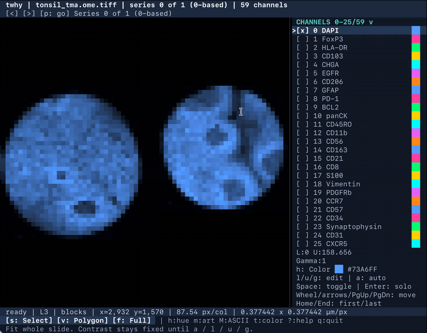
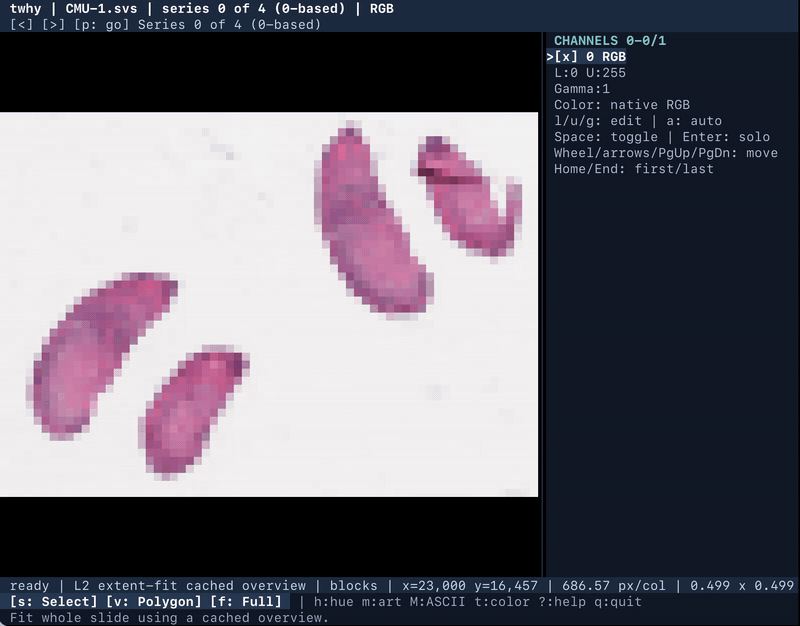
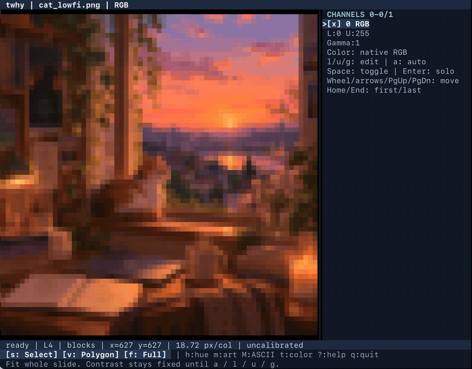
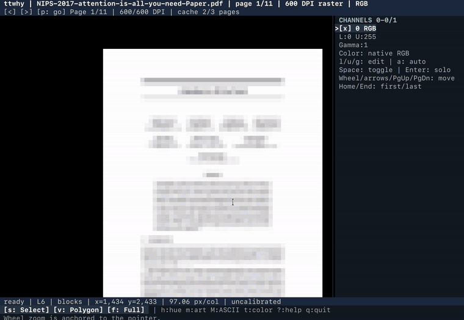
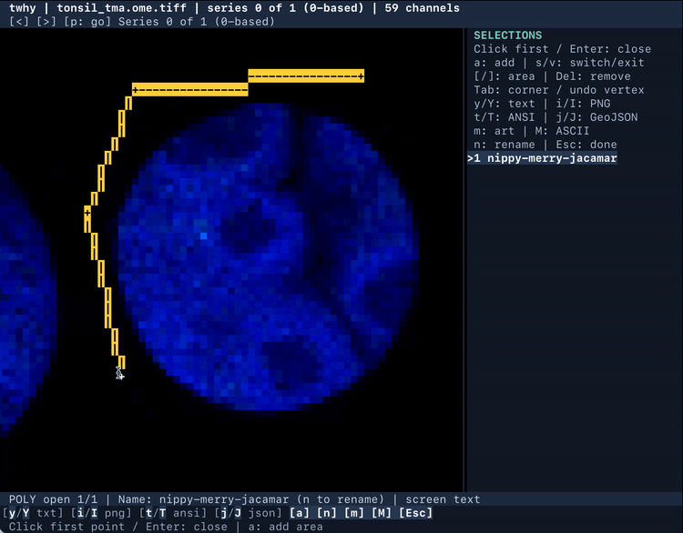

# ttwhy

**Whole-slide microscopy, ordinary images, and scientific PDFs, right in your terminal.**

`ttwhy` is a zoomable, full-screen image viewer made of *actual terminal characters*. Open an OME-TIFF, SVS, or OME-Zarr slide, explore multichannel fluorescence, inspect a PNG, or page through a PDF. No browser, image server, X11, graphics protocol, or GPU required.

<p align="center">
  <a href="docs/media/pathology.gif"></a>
</p>
<p align="center"><em>Real terminal footage: 59-channel multiplex microscopy, DAPI and CD8. Channel selection and zoom, no mock interface.</em></p>

## See it in action

These are short, automatically looping recordings of `ttwhy` itself. Click any clip to view it at full GIF size.

<table>
<tr>
<td width="50%" valign="top">
<strong>Whole-slide H&amp;E-style imagery</strong><br>
<a href="docs/media/he.gif"></a><br>
<small>Zoom from tissue-scale context into individual nuclei.</small>
</td>
<td width="50%" valign="top">
<strong>An ordinary PNG. Featuring a cat.</strong><br>
<a href="docs/media/cat.gif"></a><br>
<small>PNG, JPEG, WebP: zoom and pan familiar images, too.</small>
</td>
</tr>
<tr>
<td width="50%" valign="top">
<strong>A scientific PDF</strong><br>
<a href="docs/media/pdf.gif"></a><br>
<small>Turn pages, then zoom into figures. PDF support is standard.</small>
</td>
<td width="50%" valign="top">
<strong>Polygon selections</strong><br>
<a href="docs/media/selection.gif"></a><br>
<small>Select rectangles or polygons; export GeoJSON, text, ANSI art, or PNG.</small>
</td>
</tr>
</table>

## Install

Python **3.11+**. The **distribution name** is `ttwhy-viewer`; the executable and Python import are both `ttwhy`. (The unrelated package named `ttwhy` on PyPI is **not** this project.)

Once the distribution is published, install the standalone command without changing packages in a scientific Python environment:

```bash
uv tool install ttwhy-viewer
# or: pipx install ttwhy-viewer
# or: python -m pip install ttwhy-viewer
```

From a cloned checkout, for development:

```bash
python -m pip install -e '.[dev]'
```

PDF support is **included** in the standard install. No special extra or system PDF converter is needed.

## Quickstart

```bash
ttwhy photo.png                         # PNG, JPEG, WebP, and more
ttwhy paper.pdf                         # page navigation and progressive detail
ttwhy slide.svs                         # Aperio whole-slide RGB
ttwhy slide.ome.tif                     # OME-TIFF, grayscale or multichannel
ttwhy /data/sample.ome.zarr             # local OME-Zarr

# Compose two fluorescence channels with chosen colors:
ttwhy slide.ome.tif --channel 0 --channel 2 \
  --channel-color 0 blue --channel-color 2 cyan
```

The initial view fits the image. Wheel zoom is anchored to the pointer; pan with the mouse or arrow keys. The terminal sidebar keeps channels, colors, and contrast controls at hand.

## Why a terminal viewer?

- **Whole-slide without whole-slide RAM use:** regional TIFF/SVS reads and pyramids, with bounded previews and useful zoomed-out overviews.
- **Multichannel, not just RGB:** select channels, change pseudocolors, and adjust each marker's display window and gamma without modifying source pixels.
- **PDFs and everyday images:** ordinary images use in-memory pyramids; PDFs refine progressively from a quick preview to higher-detail pages.
- **Real characters:** colored `▀` half-blocks, Braille detail, shape-oriented Unicode art, and portable ASCII modes.
- **Selection and export:** copy/save terminal text, colored ANSI, shareable PNGs, and GeoJSON polygons/rectangles.
- **Reusable Python library:** sampling, intensity normalization, composition, and rendering are available without opening the interactive terminal UI.

`ttwhy` works over ordinary terminal sessions, including environments where a desktop image viewer is inconvenient. It is an exploratory display, **not a color-managed diagnostic viewer** and not a substitute for measuring the original pixels.

## The keys you'll actually use

| Action | Key or gesture |
|---|---|
| Zoom; pan; fit image | Wheel or `+`/`-`; arrows or drag; `r`/Home |
| Next/previous PDF page or OME series | `]` / `[` or PageDown / PageUp; `p` to jump |
| Toggle a channel; focus another | Click channel/Space; `,` and `.` |
| Adjust channel color or contrast | `h` (hue); `l`/`u` (limits); `g` (gamma); `a` (auto window) |
| Switch artwork / strict ASCII | `m` / `M`; `t` toggles artwork color; `f` toggles fullscreen |
| Select region | `s` rectangle; `v` polygon |
| Export a selection | `y/Y` text, `i/I` PNG, `t/T` ANSI, `j/J` GeoJSON (copy/save) |
| Help or quit | `?` / `q` |

## Supported files

| Format | What ttwhy does |
|---|---|
| OME-TIFF | Regional, pyramidal microscopy viewing and channel composition |
| Aperio SVS | RGB whole-slide viewing using available stored levels |
| OME-Zarr | Local and HTTP(S) stores, regional chunk reads, supported NGFF multiscales |
| PNG, JPEG, WebP, BMP, TGA, PPM | Ordinary raster viewing with zoom and pan |
| GIF, APNG, animated WebP | View a selected frame (not animation playback) |
| PDF | Navigate pages; progressively improve raster detail; copy embedded text from a rectangular selection |

For advanced flags, channel/series semantics, color modes, cache limits, clipboard behavior, and format caveats, use the **[full reference](docs/reference.md)**. Architecture notes are in [docs/architecture.md](docs/architecture.md).

## Try a synthetic microscopy example

The repo includes a deterministic fixture generator that creates public-safe, synthetic tissue-like RGB and multichannel OME-TIFFs. It is a renderer demonstration, not a biological simulation.

```bash
python examples/make_demo.py --output-directory /tmp/ttwhy-demo
ttwhy /tmp/ttwhy-demo/synthetic-mif.ome.tif --channel 0 --channel 2
```

## Python API

```python
import numpy as np
from ttwhy import TextRenderer

pixels = np.linspace(0, 1, 256**2).reshape(256, 256)
frame = TextRenderer(mode="detail", color=False).render(pixels, columns=80)
print(frame.to_text())
```

## Optional remote sources

Local files are the main workflow. `ttwhy` also supports HTTP(S) images/PDFs (bounded download) and HTTP(S) OME-Zarr (regional chunk reads). For native S3 or S3-compatible stores, install `ttwhy-viewer[s3]` and use your normal AWS credentials or an endpoint override. No S3 setup is needed for local images, slides, or PDFs. [Remote input reference](docs/reference.md#local-and-remote-inputs).

## Release media and provenance

The GIFs above are edited from real ttwhy terminal recordings; larger MP4 versions are intended for social posts, not bundled into the Python wheel. Check rights/permissions for the original microscopy images before public release. The PDF demonstration uses *Attention Is All You Need* (Vaswani et al., 2017); the histology example is pseudo-H&E imagery. Image-artwork licenses and sample provenance remain the publisher's responsibility.

## License

Apache-2.0. See [LICENSE](LICENSE).
